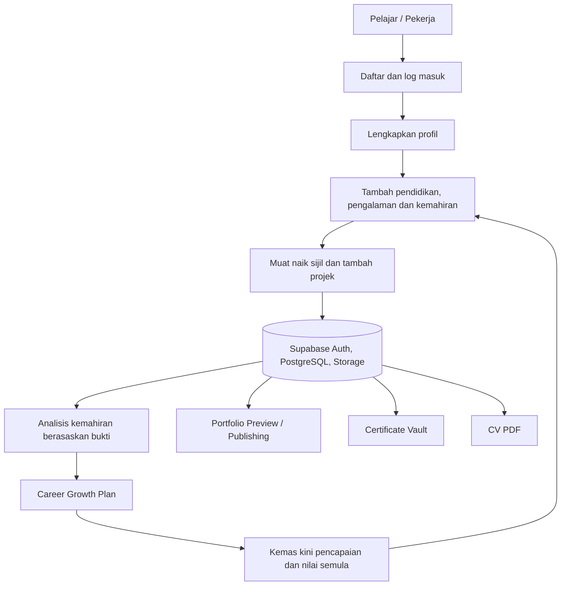

# Talent Portfolio AI — Workflow

## Sprint plan
1. Authentication, onboarding, editable user profiles.
2. Project CRUD, certificates and secure private Storage policies.
3. Portfolio templates, publishing consent, PDF resume.
4. Evidence-based skills matrix, growth roadmap and testing.

## Security principles
- Supabase Row Level Security on all owner-scoped tables.
- Uploaded documents private by default, using authorized short-lived URLs.
- Never expose service-role keys in browser or GitHub.
- Never call user-uploaded credentials verified without issuer confirmation.
- Display only consented fields on public portfolios.

## Deployment
Use Vercel only under a plan that permits the intended use; Vercel Hobby is restricted to personal/non-commercial use.
